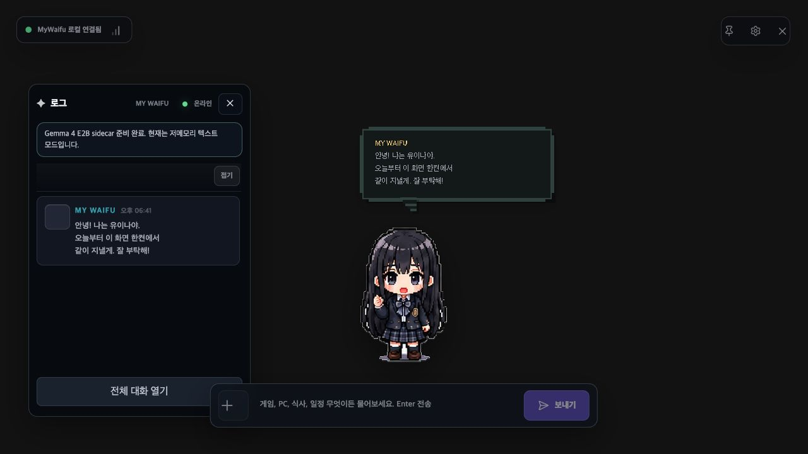
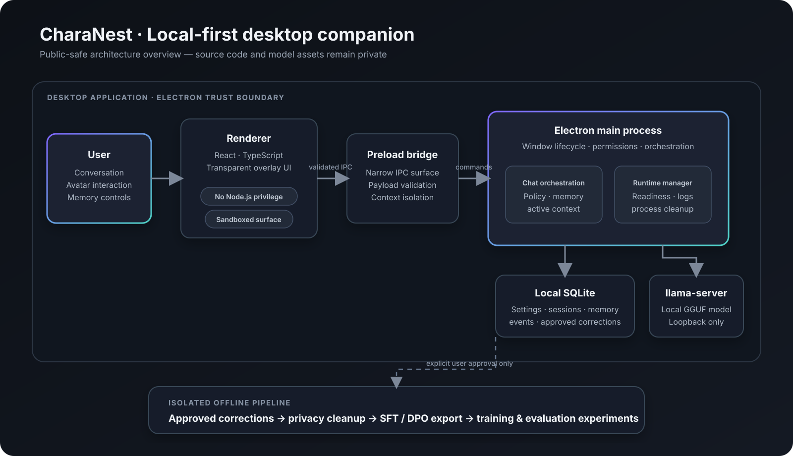
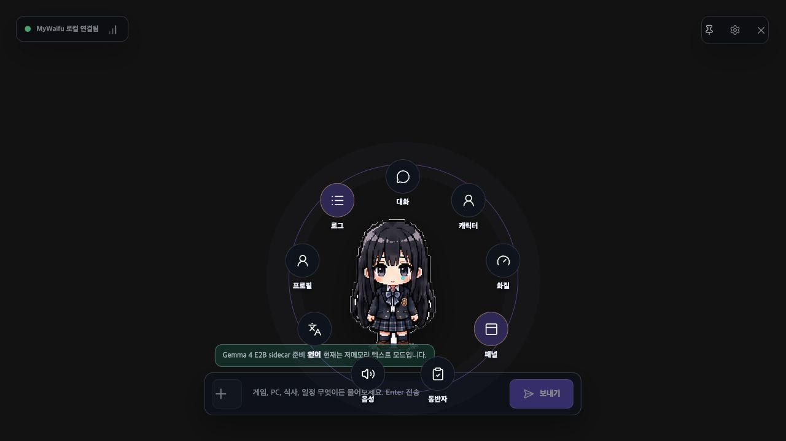
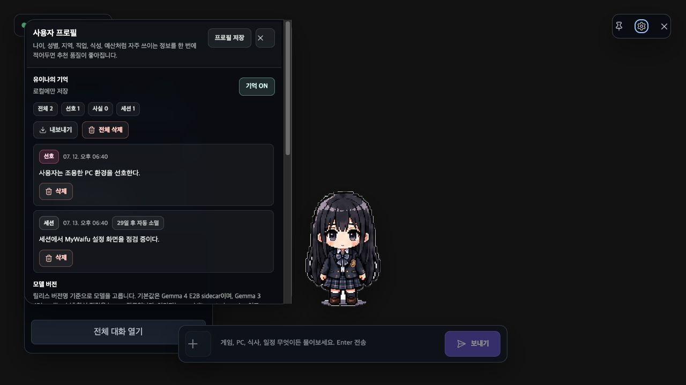
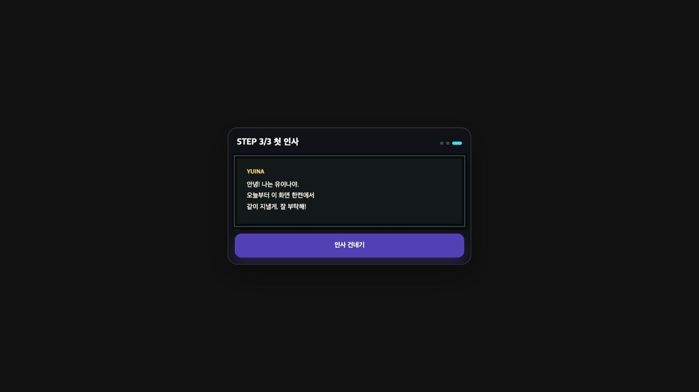

# CharaNest

> 사용자의 PC 안에서 기억하고 함께하는, 오프라인 우선 데스크톱 AI 컴패니언

[English](README.en.md) · [GitHub Profile](https://github.com/arden-deq)

CharaNest는 데스크톱 위에 머무는 픽셀 캐릭터와 대화하고, 사용자가 허용한 기억을 로컬에서 관리하는 AI 컴패니언 프로토타입입니다. 투명 Electron 오버레이와 로컬 LLM 런타임을 결합해 외부 AI API에 상시 의존하지 않는 개인적인 컴패니언 경험을 설계했습니다.

이 저장소는 포트폴리오와 기술 쇼케이스를 위한 공개 문서입니다. 제품 소스 코드, 모델 파일, 학습 데이터, 배포 자산은 비공개 저장소에서 관리합니다.

## 한눈에 보기

| 항목 | 내용 |
|---|---|
| 제품 형태 | 투명 오버레이 기반 데스크톱 AI 컴패니언 |
| 핵심 가치 | 로컬 추론, 사용자 통제형 기억, 캐릭터 중심 상호작용 |
| 담당 범위 | 제품 기획, 시스템 아키텍처, Electron 클라이언트, 로컬 LLM 통합, 평가·릴리스 자동화 |
| 주요 플랫폼 | Windows / macOS 개발·검증 |
| 현재 상태 | 비공개 개발 중인 포트폴리오 쇼케이스 — 다운로드 미제공 |

## 해결하려는 문제

클라우드 기반 AI 도우미는 편리하지만, 일상 대화가 외부 서버로 전송되고 인터넷 연결이나 API 비용에 지속적으로 의존할 수 있습니다. CharaNest는 다음 질문에서 출발했습니다.

- 개인적인 대화와 기억을 가능한 한 사용자 PC 안에 둘 수 있는가?
- 채팅창을 열어야만 만나는 도구가 아니라, 데스크톱에 자연스럽게 머무는 캐릭터를 만들 수 있는가?
- 모델 실행, 메모리, 창 제어처럼 실패 지점이 많은 데스크톱 AI를 예측 가능하게 운영할 수 있는가?

## 주요 기능

- **캐릭터 중심 오버레이** — 투명·프레임리스·항상 위 창, 아바타 드래그, 확대·축소, 말풍선, 방사형 메뉴
- **로컬 AI 런타임** — `llama.cpp`의 `llama-server` sidecar와 로컬 Gemma 계열 모델을 앱 수명주기에 맞춰 관리
- **사용자 통제형 기억** — SQLite에 로컬 저장하고, 기억 조회·개별 삭제·전체 삭제·내보내기 UI 제공
- **문맥 유지 대화** — 최근 대화, 활성 주제, 세션 요약, 현지 날짜·시간 정보를 다음 응답에 연결
- **명시적 학습 데이터 흐름** — 사용자가 승인한 답변 교정만 정리해 SFT/DPO 형식으로 내보내는 실험 파이프라인
- **생활형 컴패니언 루프** — 할 일, 집중 타이머, 누적 활동을 캐릭터 경험과 연결
- **다국어 UI** — 한국어·영어·일본어 인터페이스 문자열

## 시스템 아키텍처

Renderer는 Node.js 권한 없이 동작하고, 허용된 기능만 sandboxed preload bridge를 통해 Main process에 요청합니다. Main process가 로컬 저장소, 창 동작, 대화 orchestration, LLM sidecar의 시작과 종료를 소유합니다.

### 핵심 설계 결정

1. **오프라인 우선 제품 경로**
   일반 실행에서는 외부 검색 백엔드를 시작하지 않습니다. 최신 정보가 필요한 기능은 제품 기본 경로와 분리된 평가 하네스로 격리했습니다.

2. **앱이 소유하는 LLM sidecar**
   런타임은 loopback의 임의 고포트와 프로세스별 API key를 사용합니다. 시작 실패를 다른 모델로 조용히 숨기지 않고 사용자와 진단 로그에 드러내며, 앱 종료 시 자식 프로세스를 정리합니다.

3. **명확한 Electron 신뢰 경계**
   `contextIsolation`, renderer sandbox, 제한된 IPC surface, payload 검증을 유지해 UI 코드와 OS 권한을 분리했습니다.

4. **사용자가 소유하는 기억**
   기억은 로컬 DB에 저장되고 UI에서 확인·삭제·내보낼 수 있습니다. 자동 저장보다 동의와 가시성을 우선하는 정책을 계속 검증하고 있습니다.

## 구현에서 깊게 고민한 부분

### 1. 로컬 모델을 “기능”이 아니라 운영 대상처럼 다루기

데스크톱 앱은 모델 파일, native module, GPU/CPU 차이, sidecar 포트, 비정상 종료를 모두 감당해야 합니다. 런타임 profile, readiness probe, 프로세스 소유권, 강제 종료 경로, 진단 snapshot을 분리해 장애가 발생해도 원인을 추적할 수 있게 했습니다.

### 2. OS별 답변 차이를 재현 가능한 변수로 분해하기

Windows와 macOS에서 응답이 달라질 때 코드·모델 hash·runtime build·sampler·사용자 데이터·기능 flag를 순서대로 고정하는 교차 OS 검증 절차를 만들었습니다. “모델의 랜덤성”으로 뭉뚱그리지 않고 제품 정책, 스트리밍, 평가 fixture의 영향을 별도로 확인합니다.

### 3. 기능 통과와 출시 가능성을 분리하기

한 Windows 기준 실행에서 332개 자동화 테스트와 28개 Electron E2E 시나리오가 통과했지만, 별도의 제품 품질 gate가 기준을 충족하지 않아 출시를 보류했습니다. 테스트 개수보다 사용자 안전, 최종 UI 수렴, fallback 투명성 같은 즉시 실패 조건을 우선하는 release gate를 운영합니다.

### 4. 대화를 개선하되 데이터 통제권을 잃지 않기

사용자가 직접 수정하고 학습 사용을 승인한 답변만 export 대상으로 삼습니다. 앱의 실시간 대화 경험과 오프라인 학습·평가 파이프라인을 분리해, 제품 데이터가 자동으로 학습에 흘러가지 않도록 설계했습니다.

## 기술 스택

| 영역 | 기술 |
|---|---|
| Desktop | Electron, electron-vite, electron-builder |
| Frontend | React, TypeScript, Vite |
| Local storage | SQLite, better-sqlite3 |
| Local AI | Gemma 계열 GGUF, llama.cpp / llama-server |
| 2D / 3D | Sprite atlas, Three.js 실험 경로 |
| Training & evaluation | Python, PyTorch/Transformers, MLX, LoRA 실험, SFT/DPO export |
| Quality | Vitest, Playwright, 실제 Electron bridge 검증, failure injection |

## 화면

### 데스크톱 오버레이

대화 로그, 캐릭터 말풍선, 입력 UI가 데스크톱 위의 하나의 투명 surface에서 동작합니다.

### 캐릭터 방사형 메뉴

캐릭터를 중심으로 대화, 프로필, 로그, 설정 등 주요 기능에 접근합니다.

### 기억 제어

저장된 기억을 사용자가 직접 확인하고 삭제하거나 내보낼 수 있습니다.

### 짧은 온보딩

로컬 모델 준비와 첫 인사를 짧은 단계로 안내합니다.

> 화면은 개발 빌드에서 캡처했으며, 일부 내부 명칭과 UI는 최종 브랜딩 전에 변경될 수 있습니다.

## 저장소 공개 범위

이 공개 저장소에는 다음만 포함합니다.

- 프로젝트 소개와 설계 의사결정
- 공개 가능한 아키텍처 다이어그램
- 개발 빌드 스크린샷

다음 항목은 포함하지 않습니다.

- 애플리케이션 소스 코드와 커밋 기록
- 모델 weight, adapter, 학습·평가 데이터
- 배포 key, 환경 설정, 내부 인프라 정보
- 미공개 QA 보고서와 release asset

소스 코드가 비공개이므로 이 저장소만으로 앱을 빌드하거나 실행할 수 없습니다.

## 프로젝트 정보

- 제작 및 제공: **Dev Dot.**
- GitHub: [@arden-deq](https://github.com/arden-deq)
- 문서 기준: 2026년 8월

## 저작권

이 저장소의 문서, 다이어그램, 이미지에는 별도 허가가 없는 한 재사용 권한이 부여되지 않습니다. 자세한 내용은 [LICENSE](LICENSE)를 확인해 주세요.
